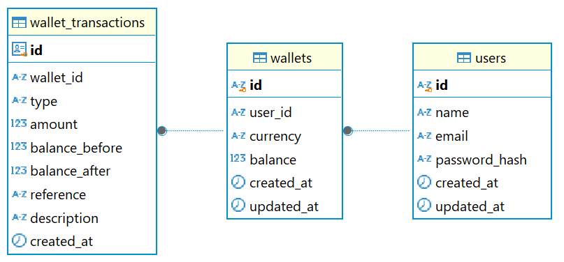

# Wallet Service

[](https://github.com/hackim18/wallet-service/actions/workflows/ci.yml)

A wallet backend in Go: user **registration and login**, **wallets**, and **deposits, withdrawals, and transaction
history**. It focuses on business logic, data consistency, and a small, clear REST API.

Started as a take-home assignment, then extended with integration tests (including a concurrency test) and CI.

---

## ✨ Features

- User registration and login (JWT)
- A default IDR wallet created for every new user
- List my wallets and check a balance
- Deposit and withdraw
- Transaction history (CREDIT / DEBIT) with pagination and a type filter

---

## 🛠️ Tech Stack

- **Language:** Go
- **Web framework:** Gin
- **Database:** PostgreSQL, accessed with GORM
- **Authentication:** JWT (Bearer token)
- **Migrations and seeding:** built-in command-line flags
- **CI:** GitHub Actions
- **Container:** Docker, Docker Compose

---

## 📦 Architecture

Layered (Clean Architecture style):

- **Controller** → HTTP layer
- **Use case** → business logic
- **Repository** → database access

Every balance change (deposit or withdrawal) runs inside **one database transaction** that:

1. locks the wallet row (`SELECT … FOR UPDATE`),
2. updates the balance in `wallets`,
3. appends a record to `wallet_transactions`.

---

## 🗄️ Database Schema

### users

- id
- name
- email
- password_hash
- created_at
- updated_at

### wallets

- id
- user_id
- currency
- balance
- created_at
- updated_at

### wallet_transactions

- id
- wallet_id
- type (CREDIT / DEBIT)
- amount
- balance_before
- balance_after
- reference
- description
- created_at

> `wallet_transactions` is **append-only**: rows are never updated, so it has no `updated_at`.



---

## 🔐 Environment Variables (.env)

```env
# Application
APP_NAME=wallet-service
PORT=8080
LOG_LEVEL=6

# PostgreSQL
DB_USERNAME=root
DB_PASSWORD=root
DB_HOST=localhost
DB_PORT=5432
DB_NAME=wallet_service
DB_POOL_IDLE=10
DB_POOL_MAX=100
DB_POOL_LIFETIME=300

# JWT
JWT_SECRET=super_secret_key

# Cleanup
DROP_TABLE_NAMES=wallet_transactions,wallets,users
```

A copy is in `.env.example`.

---

## 🚀 Running the Project

### 1. Clone

```bash
git clone https://github.com/hackim18/wallet-service.git
cd wallet-service
cp .env.example .env
```

### 2. Run

The flags can be combined:

```bash
# Full reset: drop → migrate → seed → run
go run cmd/web/main.go --drop-table --migrate --seed --run

# Migrate → seed → run
go run cmd/web/main.go --migrate --seed --run

# Migrate → run
go run cmd/web/main.go --migrate --run

# Run the server only
go run cmd/web/main.go

# Hot reload (needs Air and .air.toml)
air
```

The server listens on `http://localhost:8080`.

### Docker

`docker compose up -d --build` starts PostgreSQL and the API (migrations run on start) on `http://localhost:8080`.
Seed sample data once with `docker compose run --rm app --seed`. The image is a multi-stage build that runs as a
non-root user; set `JWT_SECRET` and `DB_PASSWORD` in your shell or a `.env` file before using it beyond local testing.

### 3. Tests

Unit tests need no database:

```bash
go test ./...
```

Integration tests need PostgreSQL. They cover deposits, withdrawals, insufficient funds, access to another user's
wallet, pagination, and **25 concurrent withdrawals** that prove `SELECT … FOR UPDATE` keeps the balance from going
negative:

```bash
docker run -d --name wallet-test-pg -e POSTGRES_PASSWORD=postgres -e POSTGRES_DB=wallet_test -p 55432:5432 postgres:16-alpine
WALLET_TEST_DATABASE_DSN="host=localhost port=55432 user=postgres password=postgres dbname=wallet_test sslmode=disable" go test -race ./...
```

Without `WALLET_TEST_DATABASE_DSN` the integration tests are skipped. GitHub Actions runs all of them against a
PostgreSQL service (`.github/workflows/ci.yml`).

---

## 🔐 Authentication Flow

1. **Register**
2. **Log in** to receive an `access_token`
3. Send it with every protected request:

```http
Authorization: Bearer <access_token>
```

---

## 📌 API Endpoints

A Postman collection is in [`api/wallet-service.postman_collection.json`](api/wallet-service.postman_collection.json).

### 👤 Auth

#### Register

```
POST /api/users/register
```

```json
{
  "email": "johndoe@mail.com",
  "password": "12345678",
  "name": "John Doe"
}
```

#### Login

```
POST /api/users/login
```

```json
{
  "email": "johndoe@mail.com",
  "password": "12345678"
}
```

### 💼 Wallets (Bearer token required)

#### List my wallets

```
GET /api/wallets
```

#### Get a wallet's balance

```
GET /api/wallets/:walletId/balance
```

#### Deposit

```
POST /api/wallets/:walletId/deposit
```

```json
{
  "amount": 50000,
  "reference": "BANK_TRX_00112233",
  "description": "Top-up via BCA"
}
```

`reference` holds the **external transaction ID**, which helps with audits and reconciliation.

#### Withdraw

```
POST /api/wallets/:walletId/withdraw
```

```json
{
  "amount": 20000,
  "reference": "WITHDRAW_001",
  "description": "Withdraw to bank"
}
```

#### Transaction history

```
GET /api/wallets/:walletId/transactions?page=1&size=10&type=CREDIT
```

Query parameters:

- `page` (default 1)
- `size` (default 20, max 100)
- `type` (optional: `CREDIT` or `DEBIT`, case-insensitive)

---

## ✅ Business Rules

- Every new user gets a **default IDR wallet** with a zero balance
- Balances are **integers** (no floating point)
- A withdrawal fails when the balance is too low
- Every deposit and withdrawal is **recorded** in `wallet_transactions`
- Users **cannot access another user's wallet** (it is reported as not found)

### 🔒 Transaction Safety

- Every balance change runs in a **database transaction**
- **Row-level locking** (`SELECT … FOR UPDATE`) serializes concurrent changes to the same wallet
- The balance **never goes negative**; an integration test runs 25 withdrawals at once to prove it

---

## 👨‍💻 Author

**Khakim**

- GitHub: [github.com/hackim18](https://github.com/hackim18)
- Portfolio: [hackimdev.vercel.app](https://hackimdev.vercel.app/)
- LinkedIn: [linkedin.com/in/khakim18](https://www.linkedin.com/in/khakim18/)

---

## 📄 License

MIT. See [LICENSE](LICENSE).
